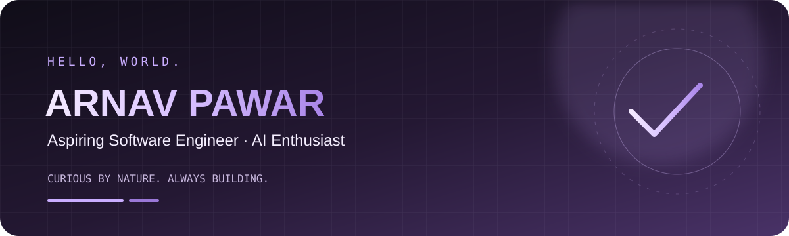
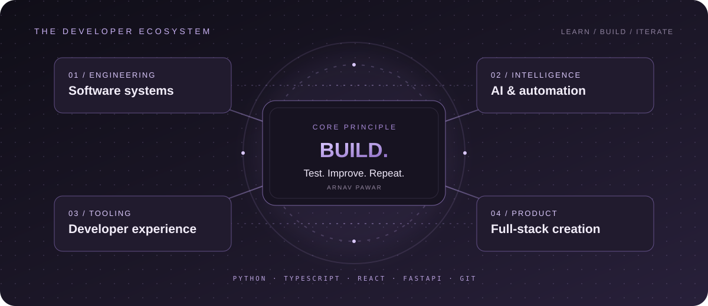

 

### Student developer · Software engineering · Artificial intelligence

*I learn by building things, breaking them, and making them better.*

---

## 01 / About

I'm Arnav, a student developer interested in how software works under the hood — from clean interfaces and useful command-line tools to APIs, automation, and AI-powered applications.

- 🔭 **Currently building:** [DevAid](https://github.com/11kzpk-1906/DevAid) — a free, local-first toolkit for developers.
- 🧠 **Exploring:** AI applications, software architecture, backend engineering, and developer experience.
- 🧪 **My approach:** Understand the problem → build a solution → test it → improve it.
- 🌱 **Long-term goal:** Become a software engineer working on useful, thoughtful technology.

## 02 / Featured projects

<table>
<tr>
<td width="50%" valign="top">

### 🧰 [DevAid](https://github.com/11kzpk-1906/DevAid)

A free, open-source, local-first developer toolkit. Project diagnostics, security checks, reports, and practical workflow utilities — designed to run locally.

**Python · Typer · Rich · CLI**

</td>
<td width="50%" valign="top">

### ✨ [ForgeAI](https://github.com/11kzpk-1906/forge-ai)

An AI assistant focused on software development, structured problem-solving, and a better developer workflow.

**React · TypeScript · FastAPI · AI**

</td>
</tr>
<tr>
<td width="50%" valign="top">

### 🌐 [Personal Portfolio](https://github.com/11kzpk-1906/Personal-Portfolio)

A web portfolio for presenting projects, experiments, and the work behind them.

**Web · UI · Responsive design**

</td>
<td width="50%" valign="top">

### 🏢 [Rajmudra Enterprises](https://github.com/11kzpk-1906/Rajmudra-Enterprises)

A business website for IT infrastructure, networking, and electronic security solutions.

**Web development · UX · Deployment**

</td>
</tr>
</table>

More experiments: [Calculator](https://github.com/11kzpk-1906/calculator) · [All repositories →](https://github.com/11kzpk-1906?tab=repositories)

## 03 / Tech stack

**Languages**

**Frameworks & tools**

## 04 / What I'm learning

| Area | Current interests |
|:--|:--|
| Software engineering | Clean architecture, data structures, testing |
| AI & automation | AI applications, agents, practical automation |
| Backend | APIs, Python, databases, system design |
| Developer tooling | CLI design, diagnostics, CI, security |
| Frontend | Responsive layouts, accessibility, thoughtful UI |

## 05 / My developer ecosystem

| THINK | BUILD | REFINE |
|:---:|:---:|:---:|
| Understand the problem | Turn ideas into working software | Test, learn, and iterate |

---

### Thanks for stopping by.

*Stay curious. Keep shipping. Make useful things.*

[Explore my repositories](https://github.com/11kzpk-1906?tab=repositories) · [Visit my profile](https://github.com/11kzpk-1906)

