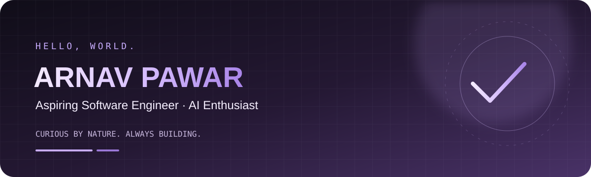

<!-- Arnav Pawar | GitHub profile README -->

  

<h1 align="center">Hey, I'm Arnav Pawar 👋</h1>

  <strong>Student Developer · Aspiring Software Engineer · AI Enthusiast</strong>

  I learn by building, experiment with ideas, and turn curiosity into projects.

  
  
  

---

## 🧑‍💻 About Me

I'm a student developer interested in **artificial intelligence, software engineering, and building useful applications**.

I enjoy exploring how systems work, designing clean interfaces, solving problems, and learning through hands-on projects. I'm still growing my skills, and every project is a chance to get better.

## 🚀 What I'm Working On

| Project | What it is |
|---|---|
| 🤖 **ForgeAI** | An AI-powered assistant focused on software engineering workflows. |
| 🌌 **Nova AI** | A Windows-first personal AI assistant experiment. |
| 📚 **Eduverse** | An educational software project. |
| 🌐 **Rajmudra Enterprises** | A website for an IT infrastructure and security solutions business. |
| 🧠 **Personal Agent** | Experiments with AI agents and helpful workflows. |

## 🧰 Tech Stack

**Languages**
 

**Frameworks & Tools**
 

## 📈 GitHub Overview

  
  

  

## 🌱 Currently Learning

- Strengthening programming and computer science fundamentals
- Building AI-powered applications and agent workflows
- Developing full-stack projects with modern tools
- Improving UI design, accessibility, and responsive layouts

## 💡 My Approach

> Build it. Break it. Understand it. Build it better.

  

  Thanks for stopping by! Have a great day. ✨

